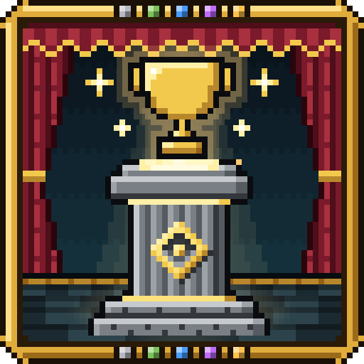

<p align="center">
  
</p>

<h1 align="center">Trophy Pedestals</h1>

<p align="center">
  <b>Show off what you've done.</b><br>
  Put any item on a pedestal in a soft cone of light, collect trophies of the mobs you slay, and line them up in cabinets and shelves.
</p>

<p align="center">
  <a href="https://modrinth.com/mod/trophypedestals"></a>
  <a href="https://www.curseforge.com/minecraft/mc-mods/trophy-pedestals"></a>
  <a href="https://discord.gg/ZapGEPqm2V"></a>
</p>
<p align="center">
  
  
  
  
  
</p>

<hr>

## ✨ About

Trophy Pedestals gives you somewhere to show off what you've done. Put any item on a pedestal and it turns slowly in a
cone of warm light; slay mobs and now and then they leave a trophy of themselves behind; defeat a player for their
statue. Then line them all up in trophy cabinets and wall shelves. It's needed **on both the client and the server**.

## 🧩 Features

- **🏛️ Pedestals.** 37 pedestals in vanilla stones and woods, each crafted from six of its material around a gold
  ingot. Put any item on one: it floats over a glowing lens, its name over it as you look. Custom pedestals of any
  block, a mod's too, come from data packs, drawn with that block's own textures.
- **🏆 Mob trophies.** Mobs you slay now and then drop a pedestal with the mob standing on it, as it looked, posed or
  animated. Bosses give epic and legendary ones, and other mods' mobs drop them too.
- **⭐ Five ranks.** Common to legendary, by how tough the mob is: each grander than the last, with outlines, flares,
  a beam, halos, a crown and sounds.
- **🗿 Player statues.** Turn on `mob_trophies.player_trophies` and a defeated player can drop their statue, in their own skin.
- **📖 Collect them all.** The Mob Trophies Ledger tracks every mob trophy you've had, rare gilded ones stand on gold, a cabinet of four Nether (or End, Ocean, Boss, Illager) mobs earns its set, and a leaderboard pedestal shows whoever leads a statistic as their statue.
- **🪟 Show them off.** Engrave a trophy's name in an anvil, close a glass case over a pedestal, or install an armor stand, dress it in a full armour set and pose it.
- **🗄️ Cabinets and shelves.** Trophy cabinets hold four trophies and stack into tall cases; wall shelves hang on walls
  and join side by side. Both come in every wood, and their gold trim can be any block (an axe takes it off).
- **🎛️ Make it yours.** Sneak and use an empty hand on a pedestal to adjust its size (up to 20 times), height,
  rotation, text, pose and animation, spin, flourishes, sounds, light, crown and redstone. Pedestals can be kept
  private to their owner. Item display pedestals keep a simpler screen by default; turn on
  `pedestals.display_pedestal_settings` in the server config to give them size, height, rotation and text controls too.
- **🧰 For packs and mods.** The `trophypedestals:set_trophy` and `trophypedestals:set_mob_trophy` loot functions,
  `/trophypedestals mob_trophy`, the `TrophyPedestals`, `TrophyKinds`, `PedestalSettings` and `PedestalRarities` APIs,
  a `TrophyPedestals` KubeJS binding (NeoForge and Forge), JEI and REI pages for mob trophies and trims, what a pedestal
  holds in Jade and The One Probe, and a trophy reward for FTB Quests. Every field, setting and API is in the
  [reference](docs/reference.md).

## 📦 Download

| CurseForge | Modrinth |
|---|---|
| [trophy-pedestals](https://www.curseforge.com/minecraft/mc-mods/trophy-pedestals) | [trophypedestals](https://modrinth.com/mod/trophypedestals) |

It needs [CoolCatLib](https://modrinth.com/mod/coolcatlib) 8.2.0 or newer, and [Fabric API](https://modrinth.com/mod/fabric-api)
on Fabric. JEI, REI, Jade, The One Probe, FTB Quests and KubeJS are optional, where they have a build for your version.

## 🧭 Versions

Each Minecraft version lives on its own branch.

| Minecraft | Loaders | Branch | Status | Latest |
|---|---|---|:-:|---|
| **26.3** | Fabric, NeoForge | [`26.3`](https://github.com/ixDarkLorD/TrophyPedestals/tree/26.3) | ✅ Supported | — |
| **26.2** | Fabric, NeoForge | [`26.2`](https://github.com/ixDarkLorD/TrophyPedestals/tree/26.2) | ✅ Supported | — |
| **26.1 – 26.1.2** | Fabric, NeoForge | [`26.1.2`](https://github.com/ixDarkLorD/TrophyPedestals/tree/26.1.2) | ✅ Supported | — |
| **1.21.1** | Fabric, NeoForge | [`1.21-1.21.1`](https://github.com/ixDarkLorD/TrophyPedestals/tree/1.21-1.21.1) | ✅ Supported | — |
| **1.20.1** | Fabric, Forge | [`1.20.1`](https://github.com/ixDarkLorD/TrophyPedestals/tree/1.20.1) | ✅ Supported | — |

## 🔌 For mod developers

Trophy Pedestals is on the [ModResources Maven](https://ixdarklord.github.io/ModResources/), free to use with no token:

```groovy
repositories {
    maven {
        name = "ModResources"
        url = "https://ixdarklord.github.io/ModResources/maven/"
    }
}

dependencies {
    compileOnly "net.ixdarklord.trophypedestals:trophypedestals-common:0.1.0+26.1.2"       // in the common module
    implementation "net.ixdarklord.trophypedestals:trophypedestals-fabric:0.1.0+26.1.2"    // in each loader's module
}
```

Artifacts are `net.ixdarklord.trophypedestals:trophypedestals-<module>:<version>+<minecraft>`, the module being
`common`, `fabric`, `neoforge` or `forge`. On 1.21.1 and older, use `modImplementation` for the loader jars. Your mod's
achievements can give trophies through the `TrophyPedestals` and `TrophyKinds` APIs: the
[reference](docs/reference.md) has them all, with examples.

## 🛠️ Building

Check out the branch for your Minecraft version, then run:

```bash
./gradlew build                        # the jars, in each loader's build/libs
./gradlew :fabric:runClient            # a game with the mod (or :neoforge: / :forge:)
./gradlew :neoforge:runGameTestServer  # the game tests (also :fabric: / :forge:)
```

It needs the Java its Minecraft version runs on (25 for 26.x, 21 for 1.21.1, 17 for 1.20.1). CoolCatLib comes from the
ModResources Maven, and the build scripts and dependency versions from
[ModResources](https://github.com/ixDarkLorD/ModResources). Every pinned version is in [docs/VERSIONS.md](docs/VERSIONS.md),
and the layout in [docs/ARCHITECTURE.md](docs/ARCHITECTURE.md).

## 🐞 Issues and ideas

Found a bug or have an idea? Open an [issue](https://github.com/ixDarkLorD/TrophyPedestals/issues), or drop by the
[Discord](https://discord.gg/ZapGEPqm2V).

## 📄 License

Trophy Pedestals is under the [Mozilla Public License 2.0](https://www.mozilla.org/en-US/MPL/2.0/). You can use it in
modpacks, make videos and reviews of it, and reuse or change its code, as long as files you change stay under the same
license.
