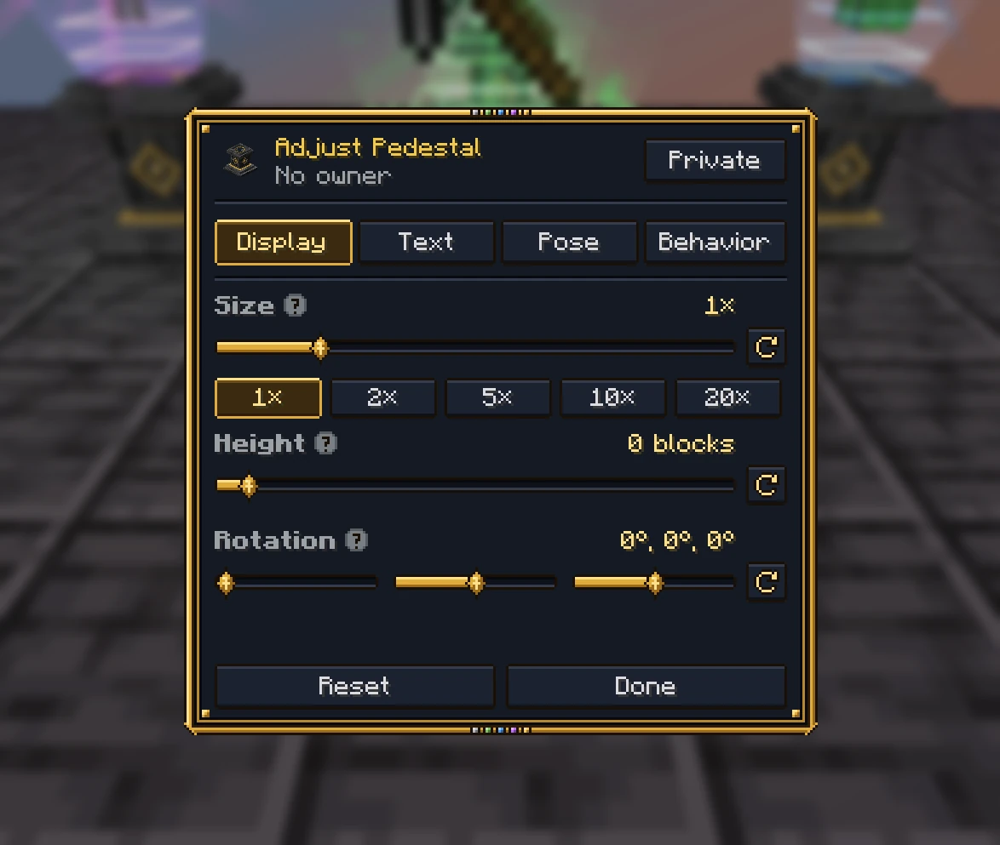
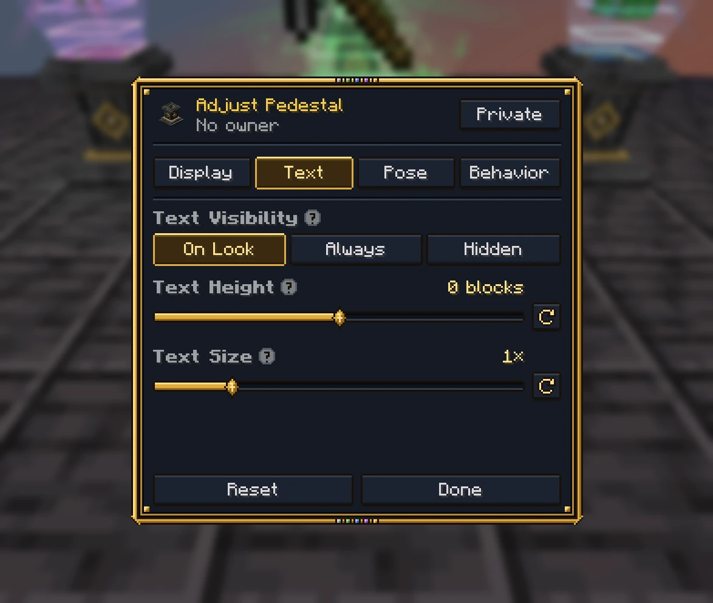
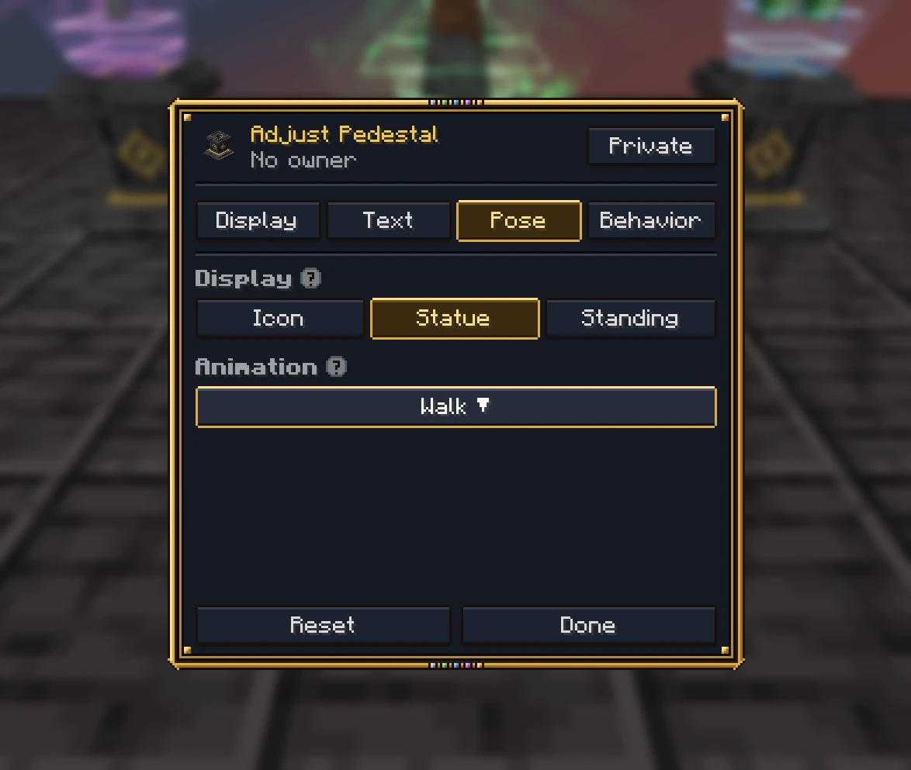

# The adjust screen

Sneak and use a pedestal with an empty hand to open its adjust screen. It has four tabs, and the last one you used
opens next time. Each section's name has a **?** that explains it while you hover over it, and so does each button on
the Behavior tab. Each slider has its own reset button, and **Reset** puts everything back.

## Display

- **Size**, from half to twenty times its usual size, with buttons for 1×, 2×, 5×, 10× and 20×. Its light,
  outlines, flare, beam, halos, crown and particles grow with it.
- **Height**, from half a block down to ten blocks up.
- **Rotation**: three sliders side by side. **Yaw** turns what it shows round to face another way (one that spins
  starts turning from here), **pitch** tips it forward or back, and **roll** rolls it onto its side, like a sword
  standing on its point. Pitch and roll go up to half a turn either way, round its middle, and turn with it as it
  spins.
- **Crown**, on a legendary trophy: the gold crown's size, and how far it's moved forward and up, to sit it on a head
  that isn't over the middle.

## Text

- **Text Visibility**: **On Look** (while you look at it within reach), **Always** (within 32 blocks) or **Hidden**.
- **Text Height**: moves the text panel up or down.
- **Text Size**: from half to three times its usual size, frame and all.

## Behavior

- **Spin**: what it shows turns slowly, or stands still.
- **Flourishes**: its rank's beam, halos, crown shards, flares and particles. Off leaves only its showcase light and
  outlines.
- **Sounds**: its rank's sounds, like the chime when it's placed.
- **Crown**: a legendary trophy's gold crown over what it shows.
- **Showcase Light**: the lit lens, the cone of light rising out of the well and its frame. Turn it off for a plain
  display, on a trophy or a display pedestal.
- **When Powered**: **Ignore** redstone, **Show** what it displays only while powered, or **Hide** it while powered.

## Pose

For a mob or a statue.

- **Display**: an achievement trophy earned by a player can show the trophy's **Icon**, or that player's **Statue**
  in their own skin, standing, crouching, swimming, gliding or sleeping (the button beside it).
- **Mob Pose**: **Animated**, or **Frozen** in one pose (which also stops a blaze's rods and an allay's wings).
- **Animation**: one animation the mob or statue plays on loop. The list is found from the mob itself, so only
  animations that move it are offered: walking, running and attacking, its own animations (a warden's roar, a camel
  sitting down), its own states (a fox sitting or sleeping, a zombie's raised arms) and its own poses (a parrot's).
  Choosing one sets a frozen mob moving.

## Who may adjust it

By default, a pedestal is adjusted by the player who placed it (and operators). Its owner can let others in from the
screen: **Private** (only them), **Team** (their team too) or **Everyone**. A server can open every pedestal to anyone
(`pedestals.access`), hide a trophy's Display, Text or Pose tab from players (`pedestals.trophy_settings`), and stop
items being taken off display pedestals ([Config](../reference/commands-config.md#config)). A mod can also lock a
pedestal's settings against every player.

## Display pedestals

A display pedestal's screen is one page: when its text shows, redstone, sounds and its showcase light. A server can
give it tabs like a trophy's (`pedestals.display_pedestal_settings`, both off by default): a **Display** tab for its
item's size, height and rotation, and a **Text** tab with its text's height and size. Its Behavior tab then has spin,
sounds, the showcase light and redstone.
